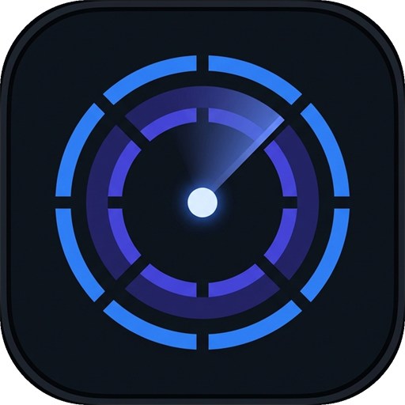

# Mercek

**Türkiye'deki özel sektör ve kamu iş ilanlarını bilgisayarınızda tamamen yerel olarak takip eden masaüstü uygulaması.**

  
  
  

 

[-2563eb?style=for-the-badge)](https://github.com/egemensaygin/mercek-releases/releases/download/v1.0.9/Mercek-Setup-1.0.9.exe)

Tek tıkla doğrudan <code>Mercek-Setup-1.0.9.exe</code> kurulum dosyasını indirir · <a href="https://github.com/egemensaygin/mercek-releases/releases/latest">Tüm Sürümler</a>

---

## Neler Sunar?

| Özellik | Açıklama |
| :--- | :--- |
| **Tek Ekranda 5 Kaynak** | **Kariyer.net**, **Eleman.net**, **LinkedIn**, **Kariyer Kapısı** ve **Kamu İlan (SBB)** ilanlarını birlikte takip eder. |
| **Akıllı Filtreleme & Kamu Uygunluğu** | Anahtar kelime, hariç tutulacak kelimeler, çalışma şekli ve aday profilinize (KPSS, YDS, bölüm, deneyim) göre ilanları süzer. |
| **Anlık Bildirimler & Sessiz Saatler** | Yeni ilan açıldığında Windows masaüstü bildirimi gönderir; belirlediğiniz saat aralığında rahatsız etmez. |
| **Başvuru Takibi & CSV Dışa Aktarma** | İlanlara Başvuruldu, Mülakat, Teklif, Olumsuz durumu ve kişisel not ekleyin; tek tıkla Excel uyumlu CSV indirin. |
| **Şirket Gizleme & Odaklı Arayüz** | İlgilenmediğiniz şirketleri tek tıkla gizleyin; klavye kısayolları ve komut paleti (Ctrl + K) ile hızla gezinin. |
| **%100 Yerel & Gizli** | Hesap açmanıza gerek yoktur. Tüm veritabanınız, filtreleriniz ve notlarınız yalnızca kendi bilgisayarınızda kalır. |

---

## Kurulum (3 Adım)

1. Yukarıdaki **Mercek v1.0.9 İndir** butonuna tıklayarak Mercek-Setup-1.0.9.exe dosyasını indirin.
2. İndirilen dosyaya çift tıklayıp kurulumu tamamlayın.
3. Mercek'i açın, ilk filtrenizi oluşturun — uygulama sistem tepsisinde arka planda ilanları takip etmeye başlar.

> [!NOTE]
> **Windows SmartScreen Uyarısı Hakkında:** Uygulama henüz kod imzalama sertifikası içermediği için ilk çalıştırmada Windows *"Bilgisayarınızı korudu"* ekranı gösterebilir. **Ek bilgi → Yine de çalıştır** adımıyla güvenle kurabilirsiniz.

> [!TIP]
> Sürüm sayfasındaki latest.yml, .blockmap ve Source code dosyaları yalnızca otomatik güncelleme altyapısı içindir; ayrıca indirmenize gerek yoktur.

---

## Sıkça Sorulan Sorular

<strong>Verilerim dışarıya gönderiliyor mu?</strong>

 
Hayır. Mercek tamamen kendi bilgisayarınızda çalışır. Filtreleriniz, aday profiliniz, favorileriniz ve başvuru notlarınız yerel SQLite veritabanınızda saklanır; hiçbir merkezi sunucuya gönderilmez.

<strong>Yeni sürümler çıktığında tekrar indirip kurmam gerekir mi?</strong>

 
Hayır. Mercek açılışta yeni sürümleri otomatik kontrol eder ve arka planda indirir. Hazır olduğunda yan menüdeki <strong>Yeniden Başlat ve Kur</strong> butonuna tıklamanız yeterlidir. Mevcut verileriniz ve filtreleriniz korunur.

<strong>Pencereyi kapattığımda tarama duruyor mu?</strong>

 
Hayır. Pencereyi kapattığınızda Mercek saatin yanındaki sistem tepsisine küçülür ve yeni ilanları arka planda takip etmeye devam eder.

